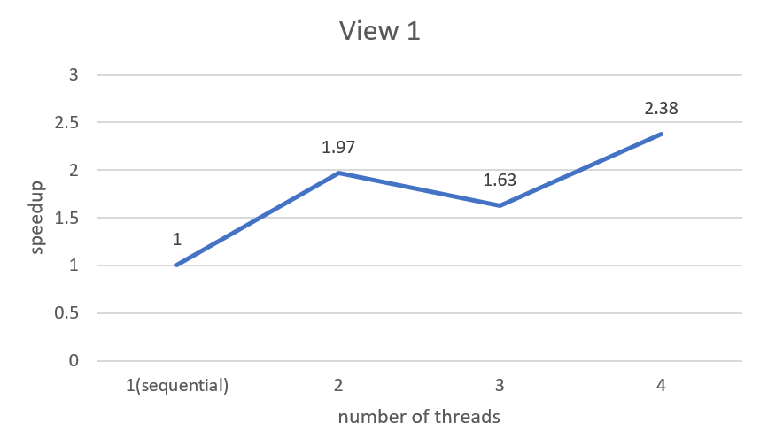
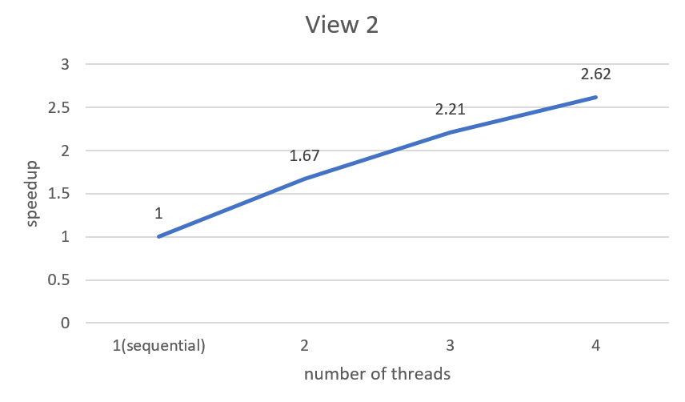
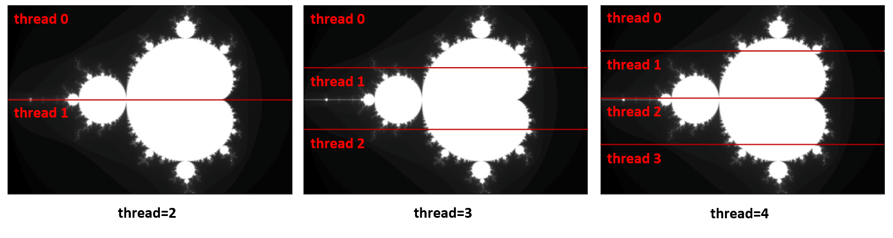
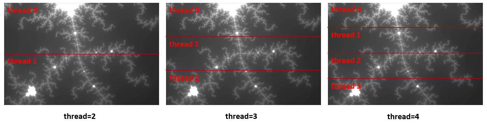
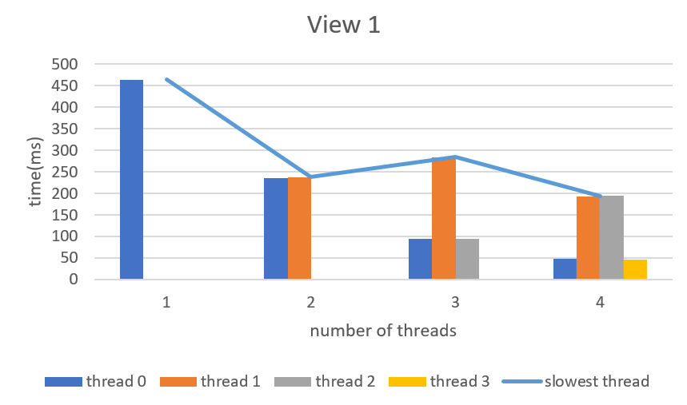
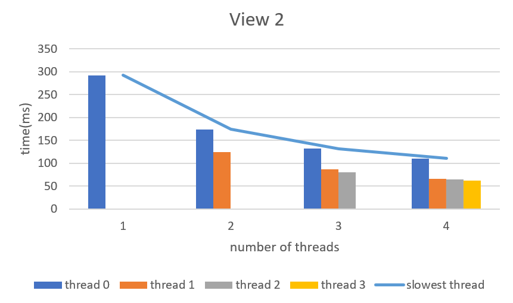
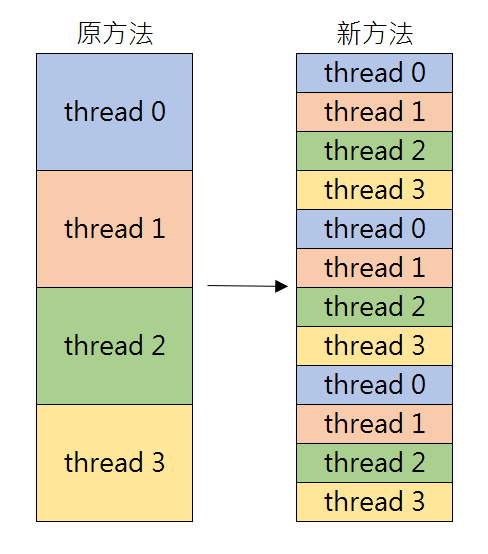

# PP-f23 HW2
資科工碩 312551080 紀軒宇

## Q1
**Q1-1: In your write-up, produce a graph of speedup compared to the reference sequential implementation as a function of the number of threads used FOR VIEW 1. Is speedup linear in the number of threads used? (You may also wish to produce a graph for VIEW 2 to help you come up with a good answer. Hint: take a careful look at the three-thread data-point.)**

在 View 1 及 View 2 中分別使用 1 至 4 個 thread 的 speedup 結果及折線圖後分別如下所示

View 1
```bash
[mandelbrot serial]:            [464.710] ms
Wrote image file mandelbrot-serial.ppm
[mandelbrot thread]:            [236.403] ms
Wrote image file mandelbrot-thread.ppm
                                (1.97x speedup from 2 threads)
[mandelbrot serial]:            [464.193] ms
Wrote image file mandelbrot-serial.ppm
[mandelbrot thread]:            [284.968] ms
Wrote image file mandelbrot-thread.ppm
                                (1.63x speedup from 3 threads)
[mandelbrot serial]:            [463.265] ms
Wrote image file mandelbrot-serial.ppm
[mandelbrot thread]:            [194.627] ms
Wrote image file mandelbrot-thread.ppm
                                (2.38x speedup from 4 threads)
```


VIEW2
```bash
[mandelbrot serial]:            [290.257] ms
Wrote image file mandelbrot-serial.ppm
[mandelbrot thread]:            [174.162] ms
Wrote image file mandelbrot-thread.ppm
                                (1.67x speedup from 2 threads)
[mandelbrot serial]:            [290.636] ms
Wrote image file mandelbrot-serial.ppm
[mandelbrot thread]:            [131.683] ms
Wrote image file mandelbrot-thread.ppm
                                (2.21x speedup from 3 threads)
[mandelbrot serial]:            [290.530] ms
Wrote image file mandelbrot-serial.ppm
[mandelbrot thread]:            [110.733] ms
Wrote image file mandelbrot-thread.ppm
                                (2.62x speedup from 4 threads)
``` 



在 View 1 中，當 thread=3 時，speedup 反而比 thread=2 少，使用的 thread 與 speedup 沒有呈現出線性關係，View 2 則有呈現些微的線性關係。

**Q1-2: In your writeup hypothesize why this is (or is not) the case? (You may also wish to produce a graph for VIEW 2 to help you come up with a good answer. Hint: take a careful look at the three-thread data-point.)**
**Ans:** 
整個計算的過程是通過每個 thread 根據其分配到的 row 分別呼叫 function `mandelbrotSerial`，而 `mandelbrotSerial` 中每個 pixel 值都是由 function `mandel`的回傳值決定的，`mandel` 部分的 code 如下：
```cpp=
static inline int mandel(float c_re, float c_im, int count)
{
  float z_re = c_re, z_im = c_im;
  int i;
  for (i = 0; i < count; ++i)
  {

    if (z_re * z_re + z_im * z_im > 4.f)
      break;

    float new_re = z_re * z_re - z_im * z_im;
    float new_im = 2.f * z_re * z_im;
    z_re = c_re + new_re;
    z_im = c_im + new_im;
  }

  return i;
}
```
可以看到，一個 pixel 需要經過的迭代次數就越多，其數值也越大，也越接近白色，所以可以知道一個 pixel 越白，計算該 pixel 時的執行時間也就越久，而我使用的方法中，因為是先把圖片沿高度平分成 thread 數量等分後再分配給各個 thread 中執行。
View 1 中，在使用不同 thread 數量下每個 thread 被分配到的區域如下圖所示：

可以發現，在 thread=3 時，thread 1 被分配到的區域都需要大量的迭代，甚至比 thread=2 時 1 個 thread 分配到的還要多，因為即使將計算的部分平行化，平行化的那個部分的執行時間還是要取決於最慢的那個 thread，所以 thread=3 的 speed up 甚至不如 thread=2。

而在 View 2 中，在使用不同 thread 數量下每個 thread 被分配到的區域如下圖所示：

因為由黑到白的 pixel 分布相較於 View 1 較為平均，各 thread 間的執行時間不會有太大的差距，最慢的 thread 跟其他的 thread 相差不大，所以 speedup 可以隨使用的 thread 數量呈線性成長。

從 View 1 跟 View 2 的分析中可以推估，造成 View 1 中 speedup 和使用的 thread 數量不呈線性關係的原因是因為分配到的 workload 不平均所導致的。


## Q2
**Q2: How do your measurements explain the speedup graph you previously created?**
**Ans:** 
我將 View 1 和 View 2 中執行過程中每個 thread 所使用的時間記錄下來，因為程式會執行多次，所以以下紀錄僅記錄最快的那次，分別如下所示
View 1
- thread=1
    ```bash
    =========================
    Thread 0 time: 463.530 ms
    =========================
    ```
- thread=2
    ```bash
    =========================
    Thread 0 time: 235.642 ms
    Thread 1 time: 237.567 ms
    =========================
    ```
- thread=3
    ```bash
    =========================
    Thread 0 time: 94.325 ms
    Thread 2 time: 94.891 ms
    Thread 1 time: 284.199 ms
    =========================
    ```
- thread=4
    ```bash
    =========================
    Thread 3 time: 45.749 ms
    Thread 0 time: 47.347 ms
    Thread 1 time: 192.659 ms
    Thread 2 time: 193.806 ms
    =========================
    ``` 
將各使用的 thread 數情況下各 thread 計算所花的時間做成長條圖，並將各使用的 thread 數下最慢的 thread 計算所花時間做成折線圖，製成表後如下：



可以發現在 thread=2 時，兩個 thread 的執行時間差不多，但是當 thread=3 時， thread 1 使用的時間大於其他兩個 thread，甚至大於 thread=2 時一個 thread 所需的時間，thread=4 時，thread 1 和 thread 2 使用的時間大於其他兩個 thread，且各使用的 thread 數下最慢的 thread 計算所花時間的趨勢剛好與 Q1 View 1 中的 speedup 相反，很好的解釋了 Q1 中的圖。

而 View 2 執行過程所有 thread 所使用的時間記錄下來，如下圖所示

- thread=1
    ```bash
    =========================
    Thread 0 time: 292.144 ms
    =========================
    ```
- thread=2
    ```bash
    =========================
    Thread 1 time: 124.870 ms
    Thread 0 time: 174.210 ms
    =========================
    ```
- thread=3
    ```bash
    =========================
    Thread 2 time: 80.293 ms
    Thread 1 time: 87.410 ms
    Thread 0 time: 132.204 ms
    =========================
    ```
- thread=4
    ```bash
    =========================
    Thread 3 time: 62.393 ms
    Thread 2 time: 64.829 ms
    Thread 1 time: 66.596 ms
    Thread 0 time: 110.680 ms
    =========================
    ```
將各使用的 thread 數情況下各 thread 計算所花的時間做成長條圖，並將各使用的 thread 數下最慢的 thread 計算所花時間做成折線圖，製成表後如下


可以發現雖然各 thread 間執行時間也有差，但是沒有像 View 1 中差距那麼大，且各使用的 thread 數下最慢的 thread 計算所花時間的趨勢剛好與 Q1 View 2 中的 speedup 相反，很好的解釋了 Q1 中的圖。


## Q3
**Q3: In your write-up, describe your approach to parallelization and report the final 4-thread speedup obtained.**
**Ans:** 從 Q2 中可以知道，導致 speedup 與使用的 thread 數量無法呈線性成長的主因是因為每個 thread 分配的 workload 不平均，所以在我的方法中，我更改了 workload 分配的方法，將原先使用 block partition 的方法改為 cyclic partition，如下圖所示：

藉由這樣的方式去平衡各 thread 之間的 workload
更改後的執行結果如下

```bash
=========================
Thread 2 time: 120.681 ms
Thread 3 time: 120.842 ms
Thread 0 time: 121.520 ms
Thread 1 time: 121.632 ms
=========================
...
[mandelbrot thread]:            [121.852] ms
Wrote image file mandelbrot-thread.ppm
                                (3.80x speedup from 4 threads)
```

從結果可以看出來，使用 thread=4 的情況的，各 thread 的時間都很平均，speedup 達到了 3.8，相較 Q2 中成長了非常多。
## Q4
**Q4: Now run your improved code with eight threads. Is performance noticeably greater than when running with four threads? Why or why not? (Notice that the workstation server provides 4 cores 4 threads.)**
**Ans:** 
執行結果如下
```bash
=========================
Thread 2 time: 60.726 ms
Thread 0 time: 60.739 ms
Thread 1 time: 91.737 ms
Thread 7 time: 81.319 ms
Thread 3 time: 117.482 ms
Thread 5 time: 102.038 ms
Thread 4 time: 119.176 ms
Thread 6 time: 105.437 ms
=========================
...
[mandelbrot thread]:            [123.273] ms
Wrote image file mandelbrot-thread.ppm
                                (3.77x speedup from 8 threads)
```
可以發現 performance 沒有提升，反而下降了。
因為 workstation 上僅有 4 個 hardware thread，所以即使使用了 8 個 thread，一次最多也只會有 4 個 thread 在跑，反而因為 context switch 的 overhead ，執行時間反而比僅用 4 個 thread 還慢。