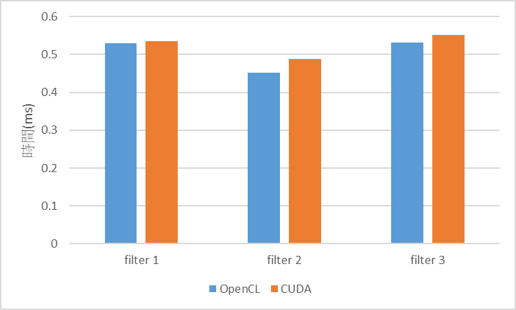

# PP-f23 HW6
資工科碩 312551080 紀軒宇

## **Q1 (5 points): Explain your implementation. How do you optimize the performance of convolution?**
### Implement & Optimize
#### `hostFE.c`
- 在 hostFE.c 中，首先先計算好 `imageSize` 跟 `filterSize`
    ```c
    int imageSize = imageHeight * imageWidth;
    int filterSize = filterWidth * filterWidth;
    ```

- 接著建立 command queue 及 kernel
    ```c
    // create command queue
    cl_command_queue commandQueue = clCreateCommandQueue(*context, *device, 0, &status);
    // create kernel
    cl_kernel kernel = clCreateKernel(*program, "convolution", &status);
    ```

- 接著建立 inputImage, outputImage, filter 的 buffer
    ```c
    // create memory buffers on the device for input, output, and filter
    cl_mem inputImageBuffer = clCreateBuffer(*context, CL_MEM_USE_HOST_PTR | CL_MEM_READ_ONLY,
                                                 imageSize * sizeof(float), inputImage, &status);
    cl_mem outputImageBuffer = clCreateBuffer(*context, CL_MEM_USE_HOST_PTR | CL_MEM_WRITE_ONLY,
                                                  imageSize * sizeof(float), outputImage, &status);
    cl_mem filterBuffer = clCreateBuffer(*context, CL_MEM_USE_HOST_PTR | CL_MEM_READ_ONLY,
                                                 filterSize * sizeof(float), filter, &status);
    ```
    - 在 inputImageBuffer, outputImageBuffer 及 filterBuffer 使用 CL_MEM_USE_HOST_PTR ，直接將 host 端上有的一段記憶體直接給 device 使用，減少傳輸時間 
- 接著傳入 kernel 所需的 arguments
    ```c
    clSetKernelArg(kernel, 0, sizeof(cl_mem), (void *)&inputImageBuffer);
    clSetKernelArg(kernel, 1, sizeof(cl_mem), (void *)&outputImageBuffer);
    clSetKernelArg(kernel, 2, sizeof(cl_mem), (void *)&filterBuffer);
    clSetKernelArg(kernel, 3, sizeof(cl_int), (void *)&imageWidth);
    clSetKernelArg(kernel, 4, sizeof(cl_int), (void *)&imageHeight);
    clSetKernelArg(kernel, 5, sizeof(cl_int), (void *)&filterWidth);
    ```

- 接著定義 global work size 跟 local work size 後直接執行 kernel
    ```c
    size_t globalWorkSize = imageSize;
    size_t localWorkSize = 32;

    clEnqueueNDRangeKernel(commandQueue, kernel, 1, NULL, &globalWorkSize,
                               &localWorkSize, 0, NULL, NULL);
    ```

- 執行完 kernel 後，將 outputImage 從 buffer 映射回 host 端
    ```c
    clEnqueueMapBuffer(commandQueue, outputImageBuffer, CL_TRUE, CL_MAP_READ,
                           0, imageSize * sizeof(float), 0, NULL, NULL, NULL);
    ```

#### `kernel.cu`
- kernel 函式宣告
    ```c
    __kernel void convolution(
        __global float *input, 
        __global float *output, 
        __constant float *filter, 
        int image_width, 
        int image_height, 
        int filter_size
        )
    ```
    - 這邊使用 filter 使用 `__constant` 存入 constant memory 加速 filter 的存取

- 初始化各類參數
    ```c
    int index = get_global_id(0);

    int filter_half = filter_size >> 1;

    int2 coord = (int2)(index % image_width, index / image_width);
    int2 filter_half_2 = (int2)(filter_half, filter_half);

    float sum = 0.0f;
    ```
    - 使用 >>1 代替除二來加速計算
    - 使用 `int2` 的資料型態來加速計算
- 捲積計算
    ```c
    for (int i = 0 ; i < filter_size ; i+=1)
    {
        for (int j = 0 ; j < filter_size ; j+=1)
        {
            float filter_value = filter[i * filter_size + j];
            if (filter_value == 0.0f)
                continue;

            int2 x_y_index;
            x_y_index = coord + (int2)(j, i) - filter_half_2;
            
            if ( x_y_index.y < 0 || x_y_index.y >= image_height || 
                 x_y_index.x < 0 || x_y_index.x >= image_width)
                continue;
            
            sum += input[x_y_index.y * image_width + x_y_index.x] * filter_value;
        }
    }

    ```
    參考 serialConv.c 實作並優化以下部分
    - 將重複裡用數次的 filter 的值暫存起來
    - 使用 `int2` 加速運算
    - 遇到 filter 中值為 0 時直接略過
- 將結果存回 output
    ```c
    output[index] = sum;
    ```
## **[Bonus] Q2 (10 points): Rewrite the program using CUDA.**
### (1) Explain your CUDA implementation
#### ```kernel function```
```c
__global__ void convKernel(
    float *inputImage, 
    float *outputImage, 
    float *filter,
    int imageHeight, 
    int imageWidth, 
    int filterWidth)
{
    int filterHalfWidth = filterWidth >> 1;
    int thisX = blockIdx.x * blockDim.x + threadIdx.x;
    int thisY = blockIdx.y * blockDim.y + threadIdx.y;

    __shared__ float filterCache[7 * 7];
    if (threadIdx.x < filterWidth && threadIdx.y < filterWidth)
    {
        filterCache[threadIdx.y * filterWidth + threadIdx.x] = filter[threadIdx.y * filterWidth + threadIdx.x];
    }
    __syncthreads();

    float sum = 0.0f;

    for (int i = 0 ; i < filterWidth ; i+=1)
    {
        for (int j = 0 ; j < filterWidth ; j+=1)
        {
            float filterValue = filterCache[i * filterWidth + j];
            if (filterValue == 0.0f)
                continue;
            int2 x_y_index = make_int2(thisX + j - filterHalfWidth, 
                                        thisY + i - filterHalfWidth);

            if (x_y_index.x < 0 || x_y_index.x >= imageWidth ||
                x_y_index.y < 0 || x_y_index.y >= imageHeight)
                continue;
            sum += inputImage[x_y_index.y * imageWidth + x_y_index.x] * filterValue ;
        }
    } 
    outputImage[thisY * imageWidth + thisX] = sum;

}
```
- 實作部分與 OpenCL 相同，只是使用 `__shared__` 實作 OpenCL 中的 `__constant`，並使用部分 thread 複製 filter 中的值至 filterCache 並設置 `__syncthreads()` 確保同步

#### `host function`
```c
#define BLOCK_SIZE 16

void hostFE(int filterWidth, float *filter, int imageHeight, int imageWidth,
            float *inputImage, float *outputImage, cl_device_id *device,
            cl_context *context, cl_program *program)
{
    int filterSize = filterWidth * filterWidth * sizeof(float);
    int imageSize = imageHeight * imageWidth * sizeof(float);

    float *d_inputImage;
    float *d_outputImage;
    float *d_filter;

    cudaMalloc(&d_inputImage, imageSize);
    cudaMemcpy(d_inputImage, inputImage, imageSize, cudaMemcpyHostToDevice);
    cudaMalloc(&d_filter, filterSize);
    cudaMemcpy(d_filter, filter, filterSize, cudaMemcpyHostToDevice);
    cudaMalloc(&d_outputImage, imageSize);
    
    dim3 threadsPerBlock(BLOCK_SIZE, BLOCK_SIZE);
    dim3 numBlocks(imageWidth / threadsPerBlock.x, imageHeight / threadsPerBlock.y);
    convKernel<<<numBlocks, threadsPerBlock>>>(d_inputImage, d_outputImage, d_filter, imageHeight, imageWidth, filterWidth);

    cudaMemcpy(outputImage, d_outputImage, imageSize, cudaMemcpyDeviceToHost);
}
```
這一部分直接沿用 OpenCL 的 `hostFE` function，並改寫呼叫 CUDA kernel，使用 `cudaMalloc`, `cudaMemcpy` 做記憶體的宣告以及資料的搬移

### (2) plot a chart to show the performance difference between using OpenCL and CUDA


### (3) explain the result.
實驗結果顯示，在三個圖片中，OpenCL 的速度皆高於 CUDA，原因研判是在資料傳輸時使用的方法不同，OpenCL 是使用 CL_MEM_USE_HOST_PTR ，直接將 host 端上有的一段記憶體直接給 device 使用，而 CUDA 的實作是使用 cudaMalloc 及 cudaMemcpy，還有資料轉移的時間，所以相較 OpenCL 較慢

